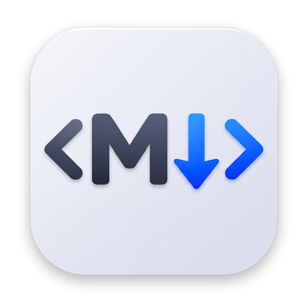

<p align="center">
  
</p>

<h1 align="center">md2HTML</h1>

<p align="center">
  <strong>Paste Markdown. Get clean, GitHub-accurate HTML instantly, side by side.</strong>
</p>

<p align="center">
  
  
  
  
</p>

<p align="center">
  <a href="https://github.com/unamatasanatarai/md2HTML/releases/latest">
    
  </a>
</p>

md2HTML is a native Mac app with one job: turning Markdown into HTML while you watch. Type or paste
on the left and the HTML source appears on the right, updated on every keystroke. You can paste it
into a CMS, an email template, or a web page.

There's no Convert button, no export dialog, and no files to save. Open the app, read the HTML, copy it.

---

## Why md2HTML

Getting HTML out of Markdown usually means a command-line tool, an online converter, or a full
editor with a preview you didn't need. md2HTML is a single window that does the conversion and
shows you the actual markup, formatted the way you'd write it by hand.

- **Instant.** Every edit re-renders the output right away: typing, pasting, cutting and undo.
- **Accurate.** Conversion runs on [cmark-gfm](Vendor/cmark-gfm/README.md), GitHub's own
  GitHub-flavored Markdown engine, bundled into the app.
- **Out of your way.** It opens with your clipboard's text already loaded, and quitting leaves nothing behind.

---

## What It Does

### Live Markdown → HTML, side by side
A resizable split window: editable Markdown on the left, read-only HTML source on the right. Both
panes use a monospaced font and wrap long lines.

### GitHub-flavored Markdown, done right
Headings, emphasis, lists, links, fenced code with language classes, **tables**, **strikethrough**,
**task lists** and **bare-URL autolinks**. Raw HTML inside your Markdown, such as `<div>`, `<br>` or
even `<style>`, passes through untouched.

### HTML you'd actually want to paste
The output is a clean fragment, with no `<html>`, `<head>` or `<body>` wrapper. It's indented two
spaces per nesting level, and whitespace inside `<pre>`, `<textarea>`, `<script>` and `<style>` is
never altered.

```html
<ul>
  <li>Ship it
    <ul>
      <li><input type="checkbox" checked="" disabled="" /> tests</li>
    </ul>
  </li>
</ul>
```

### Panes that scroll together, block by block
Scroll either side and the other follows to the **same** heading, paragraph, list, table or code
block. It doesn't just match the percentage scrolled, so long tables and code blocks stay lined up.

### Your clipboard, ready at launch
Copy some Markdown, open md2HTML, and the HTML is already there. The launch paste is:
- selected, so typing replaces it
- undoable, so ⌘Z clears it

It never loads images, files, password-manager secrets, or text over about 1 MB.

### One-step copy, with confirmation
Click the copy icon in the HTML pane's corner, or press **⇧⌘C**. A "Copied to clipboard" note
confirms it, then fades away.

### Your input, exactly as typed
Smart quotes, smart dashes, text replacement and autocorrect are all switched off. `"`, `--` and
`:)` stay as typed, and rich text pastes in as plain text.

---

## How It Works

```text
1. Copy Markdown from anywhere
2. Open md2HTML           →  your clipboard text is already converted
3. Edit on the left       →  HTML updates on every keystroke, panes stay in sync
4. Press ⇧⌘C              →  the full HTML fragment is on your clipboard
```

Everything happens locally. The Markdown engine is compiled into the app, and md2HTML makes no
network requests and stores nothing between launches.

---

## Quick Start

### Download

Get `md2HTML-<version>.dmg` from the
**[latest release](https://github.com/unamatasanatarai/md2HTML/releases/latest)**, open it, and
drag md2HTML into Applications. It's a universal app that runs natively on Apple silicon and Intel
Macs with macOS 12 or later.

> Release builds are ad-hoc signed rather than notarized. The first time you open the app, right-click it in Applications and choose **Open**.

### Build from source

**Requirements:** macOS 12 or later, with the Xcode Command Line Tools (`swiftc`, `clang`).

From the repository root:

```bash
make run     # build the app bundle and launch it
```

Other useful targets:

| Command | What it does |
|---|---|
| `make build` | Build `build/md2HTML.app` |
| `make test` | Run the test suite |
| `make dmg` | Package a styled, drag-to-install DMG in `build/` |
| `make clean` | Remove build artifacts |
| `make help` | List every target |

---

## Built to Be Trusted

- **54 automated tests** (`make test`) cover:
  - Markdown fixtures for every supported element
  - indentation rules and raw-HTML passthrough
  - the clipboard guardrails, tested on a private pasteboard
  - two-way scroll sync, the menu and shortcuts, and the copy feedback
- **A pinned engine:** cmark-gfm is vendored at a fixed upstream commit, with its license kept
  beside it. See [Vendor/cmark-gfm](Vendor/cmark-gfm/README.md).
- **A simple toolchain:** plain `swiftc` and `clang` driven by shell scripts. There's no Xcode
  project and no package manager. The C library is compiled once and cached, keyed by a hash of its
  sources.

---

## For Developers

<details>
<summary><strong>Project layout</strong></summary>

```text
Sources/App/
├── AppDelegate.swift                # Launch: menu, window, clipboard load
├── EditorWindowController.swift     # Split window, pane wiring, Copy HTML
├── MarkdownPaneViewController.swift # Editable Markdown pane
├── HTMLPaneViewController.swift     # Read-only HTML pane, copy icon, "Copied" feedback
├── MarkdownConverter.swift          # cmark-gfm → HTML fragment + block anchors
├── HTMLIndenter.swift               # Two-space indentation by element nesting
├── ScrollSynchronizer.swift         # Block-anchored two-way scroll sync
├── ScrollMap.swift                  # Piecewise-linear scroll mapping
├── ClipboardLoader.swift            # Launch clipboard guardrails
├── MainMenu.swift                   # App / Edit / Window menus
├── TextViewFactory.swift            # Plain, monospaced, no-autocorrect text views
├── ArrowRegionTextView.swift        # Arrow cursor over in-pane controls
├── HoverIconButton.swift            # Copy icon with hover state
├── AppConfig.swift                  # Name, version, build number
└── Main.swift                       # Entry point
Tests/AppTests/                      # App + converter test suites
Vendor/cmark-gfm/                    # Pinned GitHub-flavored Markdown engine
scripts/                             # build, test, cmark, DMG, release, icon & DMG art
Design/AppIcon-source.jpeg           # Source artwork for the app icon
```
</details>

<details>
<summary><strong>Build rules</strong></summary>

- **Version:** the `VERSION` file (`X.Y.Z`) is the single source of truth. **Build number:** every
  build increments `BUILD_NUMBER`.
- **Signing:** builds are ad-hoc signed with a requirement pinned to the bundle ID, so macOS
  permissions persist across rebuilds. `make revoke` resets them.
- **Universal binary:** every build targets both Apple silicon and Intel (`ARCHS="arm64 x86_64"`
  in `scripts/config.sh`), merged with `lipo`. The build fails if a slice is missing, and it
  cross-compiles, so an Intel Mac produces Apple-silicon builds and vice versa.
- **Markdown engine:** `scripts/build_cmark.sh` compiles `Vendor/cmark-gfm` for each architecture
  into one universal `libcmark-gfm.a`, cached under
  `${XDG_CACHE_HOME:-~/.cache}/md2html/cmark/<source-hash>/`.
- **App settings:** the app name, bundle ID and minimum macOS version live in
  [scripts/config.sh](scripts/config.sh). `make setup` rewrites the ID and name interactively.
</details>

<details>
<summary><strong>Icon and DMG artwork</strong></summary>

Both are generated from source, so they can be rebuilt at any time:

```bash
# Design/AppIcon-source.jpeg → Resources/AppIcon.icns + AppIcon.png
swiftc scripts/generate_app_icon.swift -o /tmp/generate_app_icon && /tmp/generate_app_icon

# Resources/dmg_background.png + @2x
swiftc scripts/generate_dmg_background.swift -o /tmp/gen_dmg_bg && /tmp/gen_dmg_bg
```
</details>

<details>
<summary><strong>Releasing</strong></summary>

**With `make release`.** Gemini writes the release notes:

```bash
export GEMINI_API_KEY="your-api-key"
make release 1.2.3
```

The version must be greater than both `VERSION` and the latest `vX.Y.Z` tag, and the working tree
must be clean. The script gathers the commits, runs the tests and shows a full preview. It changes
nothing until you type `yes`. Then it bumps `VERSION`, builds the DMG, tags, pushes and publishes
the GitHub release.

**With [`ggrel`](.release.sh).** The repository ships a `.release.sh` hook:

```bash
ggrel 1.2.3 --dry-run --notes "Preview only"
ggrel 1.2.3 -f notes.md
```

ggrel runs the tests, bumps `VERSION`, builds the DMG, commits `BUILD_NUMBER`, tags, pushes and
attaches `build/md2HTML-<version>.dmg` to the GitHub release.
</details>

---

## License

md2HTML is released under the [MIT License](LICENSE). The bundled cmark-gfm is BSD-2-Clause; see
[Vendor/cmark-gfm/COPYING](Vendor/cmark-gfm/COPYING).
